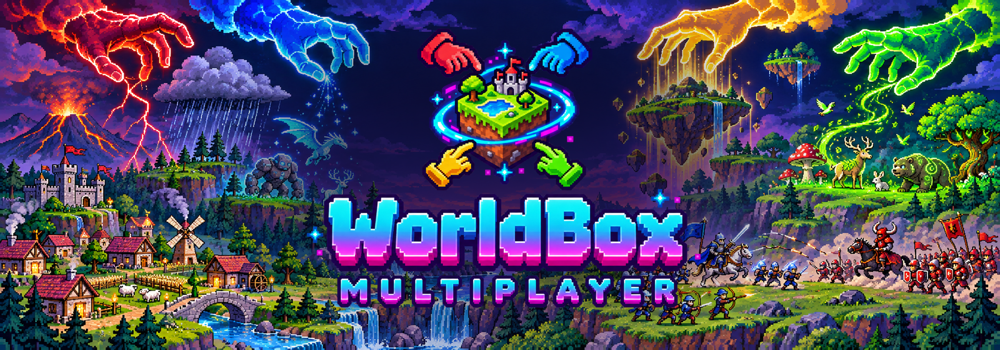
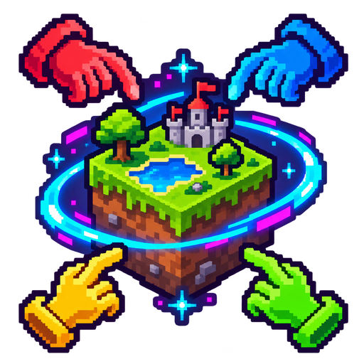
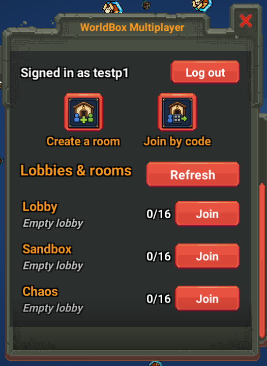
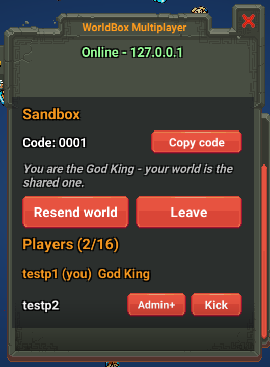
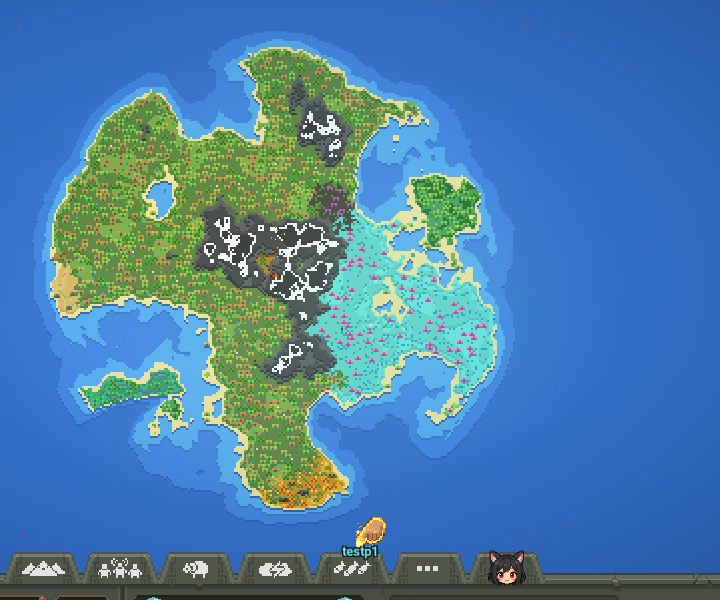
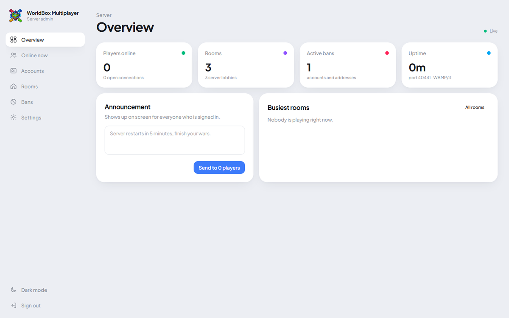
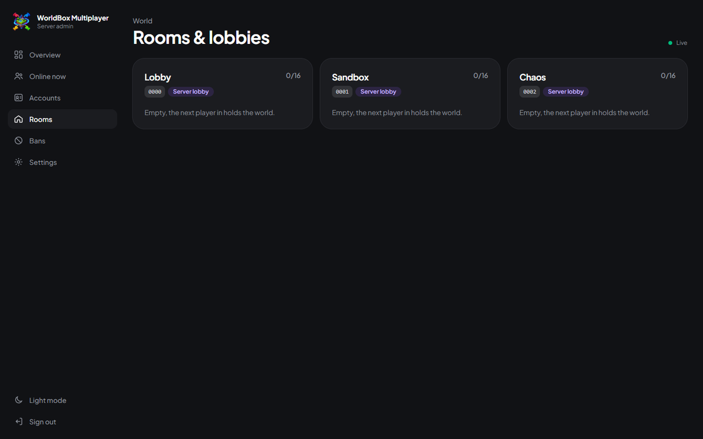
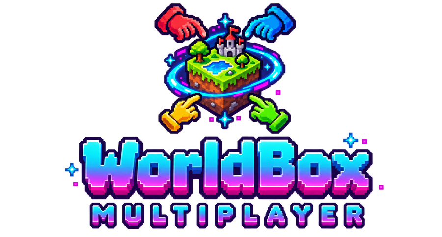

<p align="center">
  
</p>

<p align="center">
  <b>Real-time multiplayer for <a href="https://www.superworldbox.com/">WorldBox</a>.</b><br>
  One living world, many gods. Build, burn and bless it together.
</p>

<p align="center">
  <a href="https://github.com/AlizerUncaged/worldbox-multiplayer/releases"></a>
  <a href="https://github.com/AlizerUncaged/worldbox-multiplayer/wiki"></a>
</p>

<p align="center">
  
  
  
  
  
  <a href="CONTRIBUTING.md"></a>
</p>

---



## Play together in one world

WorldBox Multiplayer puts several players in the same world at the same time. Every
creature, building, kingdom, war, culture, fire, storm and god power is mirrored to the
whole room as it happens, and you see each other's god hands moving over the map.

- **Server lobbies and private rooms.** Hop into an always-open lobby, or create your own
  room with a name, an optional password and a 4-character code to share.
- **One world, one Owner.** The player who holds the world is its Owner; everyone else plays
  inside it. If the Owner leaves, ownership passes on and the world carries on.
- **Everything mirrored.** Spawns, births and deaths, movement, combat, terrain, buildings,
  cities, kingdoms, cultures, languages, religions, clans, families, armies, wars, plots,
  laws, weather, eras and projectiles.
- **Joins that just work.** New players receive the world with a progress bar and slot right
  into the live game; anything that happens while they load is replayed for them.
- **Stays connected.** "Keep me signed in" logs you back in on every launch, and a dropped
  connection reconnects and rejoins your room by itself.
- **Moderation built in.** Room admins and Owners can kick and promote; server operators get
  a web admin panel with live players, rooms, bans and announcements.
- **Moddable.** A small SDK lets other mods work inside multiplayer rooms.

## Screenshots

<p align="center">
  
  
  
</p>
<p align="center">
  
  
</p>

## Install

1. Download **`WorldBoxMultiplayer-Installer.exe`** from the
   [latest release](https://github.com/AlizerUncaged/worldbox-multiplayer/releases).
2. Close WorldBox and run it. It finds your game through Steam (or lets you pick
   `worldbox.exe`), then installs the latest **NeoModLoader** and **WorldBox Multiplayer**.
3. Turn on **Experimental Mode** in WorldBox's settings and restart the game.

A **True Multiplayer** tab appears in the toolbar; **F9** opens the multiplayer window
anywhere. Register, then join a lobby, create a room, or enter a friend's code.
Prefer doing it by hand? See [Installation](https://github.com/AlizerUncaged/worldbox-multiplayer/wiki/Installation).

<p align="center"></p>

## Host your own server

The server is one .NET 10 program with SQLite built in: nothing else to install. Download
the self-contained server for Linux or Windows from the
[releases](https://github.com/AlizerUncaged/worldbox-multiplayer/releases), or run it from
source:

```bash
./run_server.sh
```

It opens the lobbies and uses one port number for everything: **UDP 40441** for the game and
**TCP 40441** for a small REST api. Open both in your firewall.

**Settings** use standard .NET configuration: defaults in
[`src/Server/appsettings.json`](src/Server/appsettings.json) (every key documented), your
overrides and secrets in a git-ignored `appsettings.Local.json`, or environment variables
like `WBMP_Port` and `WBMP_Admin__Password`.

```json
{
  "Port": 50001,
  "Rooms": { "Lobbies": [ "Main", "Creative", "Wars" ], "MaxPlayersPerRoom": 24 },
  "Admin": { "Enabled": true, "Password": "a-long-random-password" }
}
```

**Linux with systemd:** `deploy/deploy.sh root@your.server.ip` builds, installs and runs it
as a hardened service, with your settings in `/etc/worldbox-multiplayer/appsettings.json`.

Full guide: [Hosting a Server](https://github.com/AlizerUncaged/worldbox-multiplayer/wiki/Hosting-a-Server)
and [Admin Panel](https://github.com/AlizerUncaged/worldbox-multiplayer/wiki/Admin-Panel).

## For modders

Make your mod multiplayer-ready with one class, `WorldboxMP.Client.Api.WbmpApi`:

```csharp
if (!WbmpApi.IsAuthority) return;          // only the Owner changes the world
// ... do the thing ...
WbmpApi.Send("mymod.thing", payload);      // tell every player what happened
```

Guides: [SDK Overview](https://github.com/AlizerUncaged/worldbox-multiplayer/wiki/SDK-Overview),
[API Reference](https://github.com/AlizerUncaged/worldbox-multiplayer/wiki/SDK-API-Reference),
[Examples](https://github.com/AlizerUncaged/worldbox-multiplayer/wiki/SDK-Examples).
Want to work on the mod itself? Start with
[Extending the Mod](https://github.com/AlizerUncaged/worldbox-multiplayer/wiki/Extending-the-Mod).

## Build from source

Requirements: .NET SDK 10, Python 3, and WorldBox with NeoModLoader started once (it
generates the assemblies the mod compiles against).

```bash
export WORLDBOX_DIR="/path/to/steamapps/common/worldbox"

dotnet build src/Client/WorldboxMP.Client.csproj -c Debug     # builds and installs into the game
tools/make-release.sh                                          # every release artifact in out/release/
```

Release builds connect to the official server by default; point a build at your own with
`-p:MainServerSource=http://your.host:40441`.

```
src/Shared/   protocol shared by client and server
src/Server/   game server, REST api, admin panel, accounts (.NET 10)
src/Client/   the NeoModLoader mod (.NET Framework 4.8)
installer/    one-click Windows installer (WPF)
admin-ui/     admin panel front end (Tailwind), built into the server
deploy/       systemd unit, server settings template, deploy script
docs/         architecture notes, wiki sources, images
```

The design is described in [docs/ARCHITECTURE.md](docs/ARCHITECTURE.md) and the
[Extending the Mod](https://github.com/AlizerUncaged/worldbox-multiplayer/wiki/Extending-the-Mod)
wiki page.

## Contributing

WorldBox Multiplayer is built in the open and every kind of help counts: playing and
reporting bugs, testing sync with friends, fixing code, writing docs, making art, or
building mods on the SDK.

- **Start here:** [CONTRIBUTING.md](CONTRIBUTING.md) (setup, testing with two game
  instances, how to send a pull request).
- **Found a bug or out-of-sync world?** [Open an issue](https://github.com/AlizerUncaged/worldbox-multiplayer/issues/new/choose).
- **Ideas and questions:** [Discussions](https://github.com/AlizerUncaged/worldbox-multiplayer/discussions).
- **How the sync works:** [Extending the Mod](https://github.com/AlizerUncaged/worldbox-multiplayer/wiki/Extending-the-Mod).

Thanks to everyone who has contributed:

<a href="https://github.com/AlizerUncaged/worldbox-multiplayer/graphs/contributors">
  
</a>

## License

[MIT](LICENSE), by the WorldBox Multiplayer contributors. WorldBox Multiplayer is a fan
project and is not affiliated with WorldBox or its developer.
