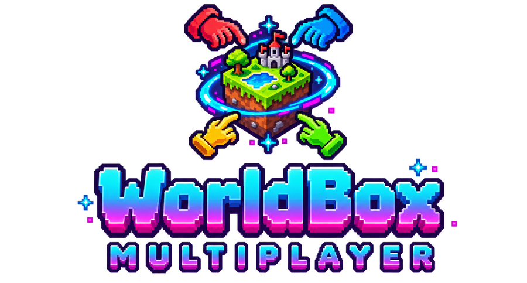

**WorldBox Multiplayer** lets several players share one living WorldBox world in real time.
Every creature, building, kingdom, war, culture and god power is mirrored to the whole room
as it happens, and you can see each other's god hands moving over the map.

## Players

- [Installation](Installation): the one-click installer, or installing by hand
- [Playing Together](Playing-Together): accounts, lobbies, rooms, roles and moderation
- [Troubleshooting](Troubleshooting): common problems and fixes

## Server hosts

- [Hosting a Server](Hosting-a-Server): run your own instance, settings, deployment
- [Admin Panel](Admin-Panel): the web dashboard for players, rooms, bans and announcements

## Modders

- [SDK Overview](SDK-Overview): make your mod work in multiplayer rooms
- [SDK API Reference](SDK-API-Reference): every member of `WbmpApi`
- [SDK Examples](SDK-Examples): complete, copy-ready plugin code
- [Extending the Mod](Extending-the-Mod): how the sync works and how to add to it

## Contributing

Everyone is welcome: bug reports, sync testing, code, docs, art and mods. Start with
[CONTRIBUTING.md](https://github.com/AlizerUncaged/worldbox-true-multiplayer/blob/main/CONTRIBUTING.md)
and [Extending the Mod](Extending-the-Mod), and say hi in
[Discussions](https://github.com/AlizerUncaged/worldbox-true-multiplayer/discussions).

## Links

- Source: <https://github.com/AlizerUncaged/worldbox-true-multiplayer>
- Releases: <https://github.com/AlizerUncaged/worldbox-true-multiplayer/releases>
- NeoModLoader: <https://github.com/WorldBoxOpenMods/ModLoader>
- License: MIT
